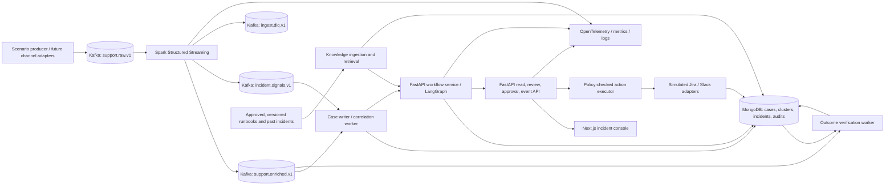

# EchoGuard AI — implementation plan

Status: approved; Phase 1–3 seeded local demos passed on 15 October 2026; Phase 4 retrieval and Phase 5 workflow live gates passed on 16 October 2026; Phase 6 HTTP console/action gate passed in the user-provided run wf-d728e70928133d7559f40b7444dc1e6a; full outcome/browser/recovery gates remain; Phase 0 smoke gate remains open

Audit (20 October 2026): see [IMPLEMENTATION_AUDIT.md](IMPLEMENTATION_AUDIT.md) for verified scope, correctness findings, outstanding deliverables, and the ordered completion plan. Seeded demo success does not mark every phase deliverable complete.

## 1. Goal, boundary, and first release

Build a working incident intelligence platform that ingests synthetic multichannel support traffic, detects abnormal complaint clusters, assembles cited evidence, proposes an action, waits for a human decision, records a simulated external action, and measures whether the signal subsides. The first release uses synthetic data and simulated Jira/Slack adapters. It must be runnable locally, reproducible, observable, and evaluated against labeled scenarios.

The first release will **not** change production systems, send real customer messages, or infer that a problem is resolved merely because a ticket was created. External integrations and real customer data are later gated extensions.

## 2. System architecture

**Service responsibilities.** Spark performs schema validation, event-time handling, deduplication, normalization, windowed aggregates, and deterministic candidate signals. It does not call LLMs. A correlation worker links signals to canonical clusters using product area, error code, time, and semantic similarity; it merges or reopens existing incidents under explicit rules. The workflow service runs bounded LangGraph nodes: triage → investigate → retrieve → plan → validate → human review → action → verify. FastAPI owns authenticated APIs and server-sent events for the console. MongoDB stores operational records and immutable audit events. Kafka carries replayable events; MongoDB is the system of record for decisions and action status.

**Retrieval deployment decision.** Use a `Retriever` interface. For local Compose, store documents in MongoDB, use its text index for exact terms, and use a bounded application-side vector scan with reciprocal-rank fusion. Move to an indexed vector adapter when the approved corpus exceeds the local scan limit. For an Atlas-backed environment, use Atlas Search + Vector Search with `$rankFusion` when the cluster supports it. Record index/embedding versions and compare both paths on the same evaluation set. Native MongoDB fusion has version prerequisites, so do not make Atlas mandatory for the local demo. [MongoDB hybrid search documentation](https://www.mongodb.com/docs/search/tutorial/hybrid-search/).

## 3. Contracts and data model

All events use versioned JSON schemas, UTC timestamps, `tenant_id`, `trace_id`, `schema_version`, and a stable `event_id`. Reject unknown or malformed required fields into a DLQ with a redacted reason and source offset. Partition raw events by `tenant_id + customer_id` and signals by `tenant_id + signal_key`; never mix tenants in correlation or retrieval.

| Contract / collection | Required fields and behavior |
| --- | --- |
| `support.raw.v1` | `event_id`, source/channel, source message ID, event time, ingest time, tenant, customer pseudonym, product, text, optional error code and metadata. Producer retries retain the same `event_id`. |
| `support.enriched.v1` | Original ID, normalized text, extracted error code/product, language, redaction status, processing version. Duplicate logical input yields the same enriched key. |
| `incident.signals.v1` | Deterministic `signal_id`, window start/end, grouping key, current count, baseline count, ratio, distinct customers, sample event IDs, rule/model version. Signals are candidates, not confirmed incidents. |
| `cases` | Unique `(tenant_id, event_id)`; source provenance and redacted text; retention and deletion metadata. |
| `clusters` / `incidents` | Stable cluster/incident ID, membership references, severity, status, evidence IDs, hypothesis, uncertainty, proposal, owner, version, timestamps. Use optimistic version checks for concurrent updates. |
| `knowledge_documents` | Document ID, version, approval status, source, effective date, chunk ID, embedding version, text/hash. Only approved versions are retrievable for recommendations. |
| `workflow_runs` / `approvals` / `actions` / `audit_events` | Graph checkpoint reference, stage outputs, decision actor/time, proposal hash, action idempotency key, result, append-only audit metadata. |

Incident lifecycle: `candidate → investigating → needs_review → approved | rejected → action_pending → action_succeeded | action_failed → monitoring → resolved | reopened`. State changes require a validated transition and audit event. Approval binds an actor to an exact proposal hash and incident version; any edited proposal requires a new approval. A unique action key `(incident_id, proposal_version, action_type)` prevents repeat ticket creation. A transactional outbox in MongoDB records action intent and audit atomically where deployment supports transactions; the executor retries until it records the adapter result. Simulated adapters also enforce idempotency keys. Kafka and Spark output can be delivered more than once, so consumers and MongoDB writes must be idempotent rather than claiming end-to-end exactly-once delivery. [Spark Kafka integration guide](https://spark.apache.org/docs/latest/streaming/structured-streaming-kafka-integration.html).

## 4. Detection, reasoning, and action design

1. **Streaming candidate detection:** use event-time windows with a defined lateness watermark, bounded deduplication state, and per-product/error-code counts. Require minimum volume and distinct customers plus a baseline-relative spike. Produce both exact-code and broader product signals. Set baseline and thresholds from labeled normal traffic; never treat the illustrative 10:05–10:10 story as an SLO. Late data beyond the watermark goes to a reconciliation path and is measured.
2. **Incident correlation:** deterministic keys first; semantic similarity second, bounded by same tenant, product, and time horizon. Persist merge/split rationale and references. Apply suppression/cooldown so one ongoing incident is updated rather than duplicated; allow manual split/merge from the console with audit records.
3. **Agent state:** typed Pydantic input/output for every node. Store evidence IDs, retrieval citations, confidence, model/prompt/version, and reasons for abstention. The LLM may propose a severity or hypothesis; deterministic validators enforce schema, supported citation IDs, policy, and allowed transitions. Low confidence, missing knowledge, or failed validation routes to review with an explicit “insufficient evidence” status.
4. **Retrieval:** ingest only approved, versioned runbooks and synthetic historical incidents; chunk with stable IDs; filter by tenant/product/effective status. Combine exact error-code and semantic results, then rerank a bounded candidate set. Citations point to document ID, version, and chunk; unsupported claims are removed or marked uncertain.
5. **Approval and execution:** a review role may approve/reject. The server verifies authentication, role, proposal hash, incident version, action allowlist, and expiry before execution. Only simulated `create_ticket` and `post_internal_notification` tools exist in v1. No free-form model-generated API call or arbitrary URL can reach the executor. Record who approved what, when, and adapter response.
6. **Verification:** compare post-action incoming complaint rate, distinct affected customers, and status/error telemetry against the pre-action window. Report “improving”, “unchanged”, “worsening”, or “insufficient data”, with a monitoring period and provenance. A human closes the incident; the system can recommend reopening.

LangGraph's persisted checkpoints and interrupt/resume pattern support the review boundary; we still validate approvals in the API and action executor because graph state alone is not an authorization mechanism. [LangGraph documentation](https://docs.langchain.com/oss/javascript/langgraph/thinking-in-langgraph).

## 5. Reliability, security, and operations requirements

- **Replay and recovery:** persistent Spark checkpoint volume; fixed topic retention for replay; per-consumer offsets; dead-letter queue and redrive command; idempotent upserts. Test restart mid-batch and mid-action. Do not reuse incompatible checkpoints after query changes; document migration/replay procedure.
- **Failure behavior:** Kafka unavailable → producers back off and expose lag; Spark unavailable → backlog remains in Kafka; MongoDB unavailable → consumers retry without committing progress; LLM unavailable/timeouts → deterministic signal and case remain visible, workflow enters `needs_review`; retriever unavailable → no generated resolution plan; action adapter unavailable → `action_pending` with bounded retry and operator alert.
- **Privacy and access:** synthetic data by default. Before any real data, define retention, field-level PII minimization/redaction before embeddings or model calls, tenant isolation, encryption in transit/at rest, secrets outside Git, role-based access, and audit retention. Never place raw customer text in telemetry. Treat support messages and retrieved documents as untrusted input; prompts cannot grant tool permissions.
- **Observability:** propagate trace IDs across Kafka, Spark, API, workflow, and executor. Expose consumer lag, watermark delay, DLQ rate, signal-to-console latency, workflow failure/abstention rate, retrieval latency, model tokens/cost, action retries, and approval age. Dashboards and alerts distinguish pipeline failure from no incidents. [OpenTelemetry Python guidance](https://opentelemetry.io/docs/languages/python/).
- **Deployment:** Compose for local Kafka, Spark, MongoDB, API/worker, UI, observability, and deterministic mock LLM. Pin compatible versions after a small integration spike and record them in lockfiles/images. Add health checks, persistent volumes, startup ordering, `.env.example`, seed/reset scripts, CI, and a one-command demo. Atlas and live model credentials are optional environment profiles.

## 6. Phase-by-phase execution and exit gates

Each phase ends with a running artifact, automated checks, and a short demo. A later phase begins only after its gate passes. Indicative effort assumes one engineer with access to a normal development machine; estimates will be revised after Phase 0.

| Phase | Build and deliverables | Exit gate | Indicative effort |
| --- | --- | --- | --- |
| **0. Foundation and contracts** | Isolated top-level `backend` and `frontend` folders (`backend/api`, `backend/stream`, `backend/worker`, `backend/contracts`, `frontend`, `infra`, `evals`); ADRs; threat model; JSON schemas; Compose; CI; fixture seed. Verify host capacity and compatible Kafka/Spark/Mongo versions. | `docker compose up` reaches healthy services; schema compatibility and smoke checks pass. | 3–5 days |
| **1. Data generation and ingestion** | Reproducible scenario generator with normal traffic, duplicate IDs, delayed/out-of-order data, payment spike, unrelated spike, malformed events; Kafka topics, partitions, DLQ, seed control. | Same seed yields same labeled sequence; raw count, duplicate, and DLQ assertions pass; replay works. | 3–5 days |
| **2. Streaming intelligence** | PySpark normalization, PII redaction, watermark/deduplication, baseline and spike logic, enriched/signals topics, checkpointing, metrics. | Labeled payment spike emits one candidate within configured test window; duplicates and restart do not create extra logical signals; late-event policy verified. | 5–8 days |
| **3. Case store and correlation** | Idempotent writers, cases/clusters/incidents collections and indexes, deterministic+semantic correlation, merge/reopen rules, incident lifecycle and audit ledger. | Replayed topics produce the same logical cases/clusters; concurrent updates and tenant separation tests pass. | 5–8 days |
| **4. Knowledge and retrieval** | Approved runbook pipeline, document/version registry, text+vector retrieval adapters, citation contract, retrieval evaluation set. | Exact error codes and paraphrases retrieve relevant approved chunks; expired/unapproved or cross-tenant docs never appear; baseline metrics recorded. | 4–7 days |
| **5. Controlled agent workflow** | LangGraph nodes, typed state/checkpointing, provider-independent LLM adapter and deterministic mock, validation, abstention, approval interrupt, cost accounting. | Full workflow pauses for approval and resumes once; malformed output, prompt injection, missing citations, and LLM outage fail safely. | 6–10 days |
| **6. Console and action loop** | Auth/RBAC, incident list/detail, live SSE, evidence and citations, edit/approve/reject, simulated adapters, outbox, action history, verification view. | Reviewer can complete the scenario end to end; stale approval, double click, wrong role, and repeated delivery cannot duplicate action. | 6–10 days |
| **7. Hardening and evaluation** | Load/recovery/security suites, dashboards/alerts, benchmark report, runbooks, backup/restore and replay drill, CI gates. Tune thresholds on training scenarios and report held-out results. | All release criteria below met, or a documented gap and revised target is approved. | 5–8 days |
| **8. Release package** | Tagged local demo, setup/operator guide, architecture diagrams, recorded walkthrough, known limitations, next-stage production backlog. | Fresh-machine run completes seeded incident through verified outcome with no manual DB edits. | 2–3 days |

Estimated total: **39–64 engineering days** for one engineer, subject to Phase 0 measurements and scope choices. Parallel staffing can shorten elapsed time, but integration and evaluation gates remain.

## 7. Evaluation and release criteria

Create a held-out labeled corpus of at least 20 scenarios spanning true spikes, ordinary surges, duplicates, delayed events, overlapping incidents, rare errors, and adversarial text. Report confidence intervals where sample size permits; avoid claiming production generalization from synthetic data. Capture a no-AI/rule-only baseline and compare the full workflow against it.

| Metric | Definition and initial release gate |
| --- | --- |
| Incident precision / recall | Match incident clusters to labeled scenarios; initial **≥0.85 precision and ≥0.80 recall** on held-out synthetic scenarios, with per-scenario errors documented. |
| Detection and console latency | Event time to visible candidate, measured at a stated load; initial **p95 ≤60 s** for on-time events at 100 messages/s locally, excluding intentionally late events. Tune after Phase 2 baseline. |
| Retrieval quality | Recall@5 for approved source chunks **≥0.85**; 100% of displayed citations resolve to an approved version. |
| Groundedness | Human review of sampled plans: **≥95%** of actionable steps supported by cited chunks; unsupported steps blocked from approval. |
| Action safety | **Zero** unapproved, stale, wrong-role, duplicate, or off-allowlist actions in negative tests. |
| Resilience | Simulated process-restart drills for Kafka/Spark/worker/LLM/Mongo recover without lost acknowledged inputs or duplicate logical actions; document any DLQ entries. Disk loss and multi-node failover require a later deployment profile. |
| Business proxy | Median detection-to-review time improves over manual scan baseline on identical scenarios; report absolute times and variance, not a preselected percentage. |
| Cost | Tokens, retrieval calls, and estimated spend per completed workflow; report failed/abstained workflow cost separately. |

Tests include unit checks for rules/state transitions, contract tests for topics/APIs, integration tests with real local Kafka/Spark/Mongo, and end-to-end Playwright review flows. Load tests use fixed seeds, event rates, hardware description, and reproducible scripts. CI runs quick checks on each change and scheduled heavier integration/evaluation runs.

## 8. API and console slice

Initial API: `GET /health`, `GET /incidents`, `GET /incidents/{id}`, `GET /incidents/{id}/events` (SSE), `POST /incidents/{id}/proposal`, `POST /incidents/{id}/approve`, `POST /incidents/{id}/reject`, `GET /audit?incident_id=...`, `GET /metrics` (internal). Mutations require auth, an idempotency key, expected incident version, and audit capture. The console shows alert timeline, cluster evidence with source/time, severity rationale, retrieved document versions, proposed actions and draft messages, reviewer edits, approval history, executor result, and post-action trend. The UI labels hypotheses and uncertain outcomes clearly.

## 9. Decisions to lock during Phase 0

1. Local-first deployment is the default. Atlas hybrid search and a live model are optional adapters until credentials and budget are available.
2. Synthetic payment failures are the reference scenario; no real support data or external actions in v1.
3. Choose exact supported dependency versions and checkpoint configuration through a containerized integration spike; pin after it passes.
4. Record initial thresholds and SLOs as testable hypotheses, then recalibrate from Phase 2/7 evidence.

Development begins with Phase 0 after approval of this plan.
